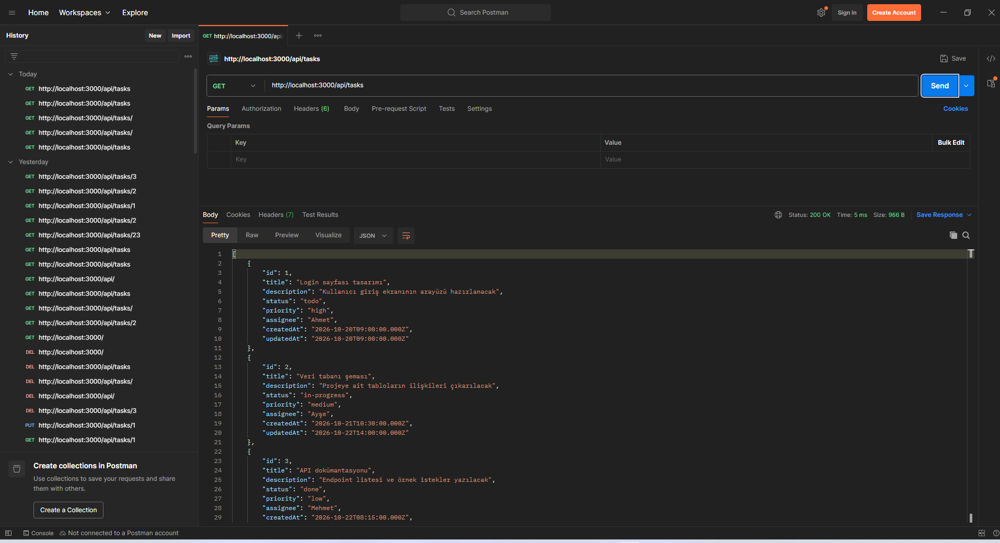
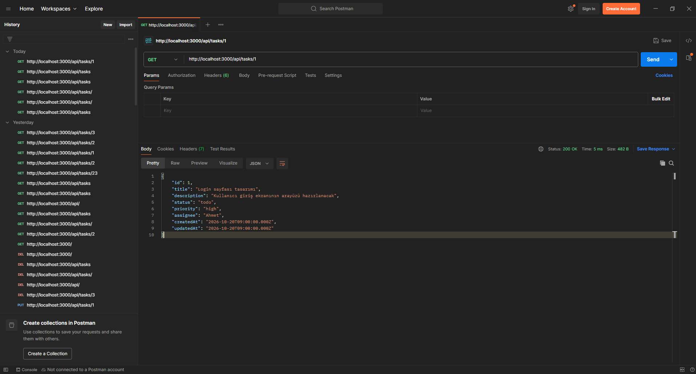
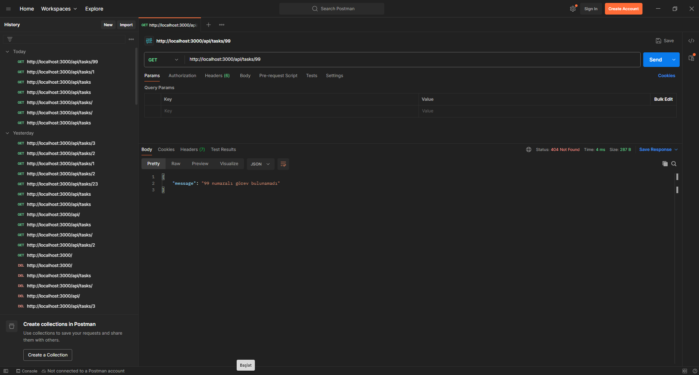
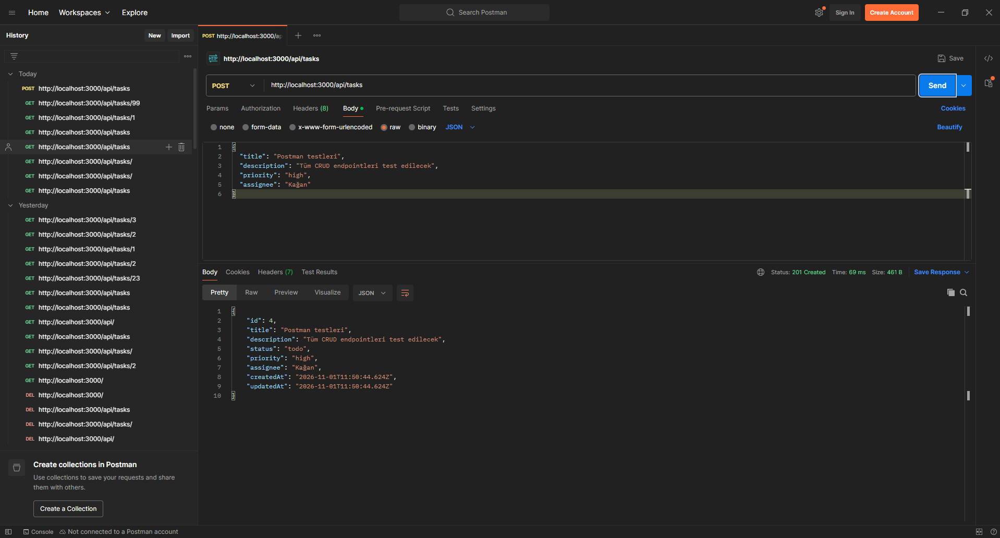
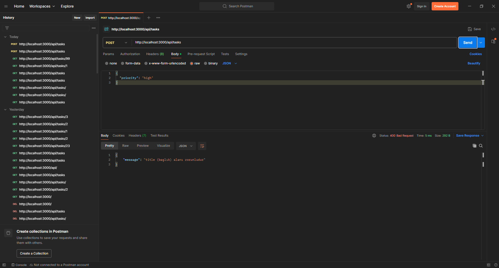
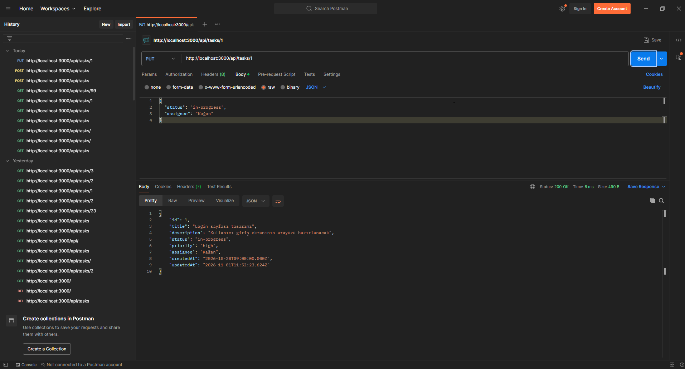
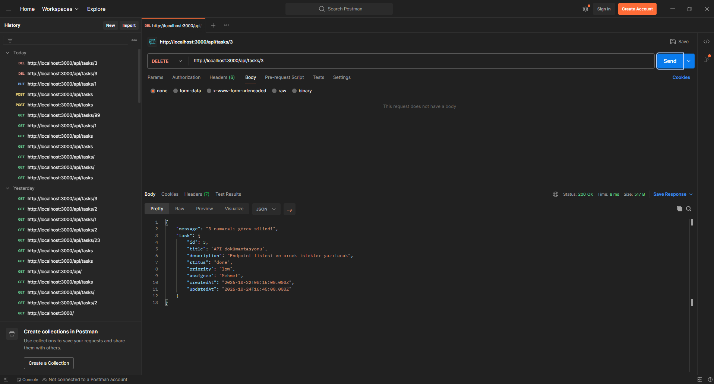
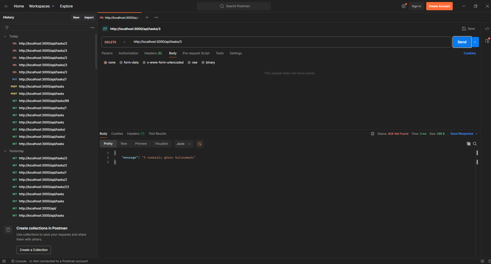
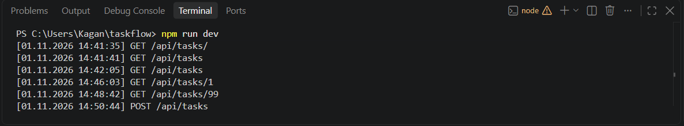

# TaskFlow – Görev ve Proje Yönetim Sistemi API

Node.js ve Express.js ile geliştirilmiş, görevlerin oluşturulmasını, çalışanlara atanmasını, durum ve öncelik takibini sağlayan bir REST API projesidir.

## Kullanılan Teknolojiler

- **Node.js** – Çalışma ortamı
- **Express.js 5** – Web framework
- **Nodemon** – Geliştirme sırasında otomatik yeniden başlatma
- **Postman** – API testleri

## Klasör Yapısı

```
taskflow/
├── server.js                    # Uygulamanın giriş noktası
├── package.json
├── screenshots/                 # Postman test ekran görüntüleri
└── src/
    ├── controllers/
    │   └── taskController.js    # CRUD iş mantığı
    ├── data/
    │   └── tasks.js             # Bellek içi veri (örnek görevler)
    ├── middlewares/
    │   └── logger.js            # İstek loglama middleware'i
    └── routes/
        └── taskRoutes.js        # Endpoint tanımları
```

## Kurulum ve Çalıştırma

**Gereksinimler:** Node.js (v18 veya üzeri) ve npm

1. Repoyu bilgisayarınıza indirin:
   ```bash
   git clone https://github.com/Kaganucar/taskflow.git
   cd taskflow
   ```
2. Bağımlılıkları yükleyin:
   ```bash
   npm install
   ```
3. Sunucuyu başlatın:
   ```bash
   npm run dev     # geliştirme modu (nodemon)
   # veya
   npm start       # normal mod
   ```
4. Sunucu `http://localhost:3000` adresinde çalışır.

> Not: Veriler bellekte tutulur. Sunucu yeniden başlatıldığında örnek görevlere geri döner.

## API Endpoint'leri

| Yöntem | Endpoint | Açıklama | Başarılı Cevap |
|---|---|---|---|
| GET | `/api/tasks` | Tüm görevleri listeler | 200 |
| GET | `/api/tasks/:id` | Tek bir görevin detayını getirir | 200 / 404 |
| POST | `/api/tasks` | Yeni görev ekler | 201 / 400 |
| PUT | `/api/tasks/:id` | Görevi günceller (sadece gönderilen alanlar) | 200 / 404 |
| DELETE | `/api/tasks/:id` | Görevi siler | 200 / 404 |

### Görev Veri Modeli

| Alan | Tip | Açıklama |
|---|---|---|
| `id` | number | Otomatik atanır |
| `title` | string | Görev başlığı (**zorunlu**) |
| `description` | string | Görev açıklaması |
| `status` | string | `todo` \| `in-progress` \| `done` (varsayılan: `todo`) |
| `priority` | string | `low` \| `medium` \| `high` (varsayılan: `medium`) |
| `assignee` | string | Görevin atandığı çalışan |
| `createdAt` | string | Oluşturulma zamanı (ISO) |
| `updatedAt` | string | Son güncellenme zamanı (ISO) |

### Örnek İstek – Görev Ekleme

`POST /api/tasks`

```json
{
  "title": "Postman testleri",
  "description": "Tüm CRUD endpointleri test edilecek",
  "priority": "high",
  "assignee": "Kağan"
}
```

## Logger Middleware

Her API isteği; zaman damgası, HTTP yöntemi ve endpoint bilgisiyle konsola kaydedilir:

```
[31.10.2026 19:30:12] GET /api/tasks
[31.10.2026 19:30:20] POST /api/tasks
```

## Postman Test Ekran Görüntüleri

| Test | Görüntü |
|---|---|
| Görevleri listeleme |  |
| Görev detayı |  |
| Görev detayı – bulunamadı (404) |  |
| Görev ekleme |  |
| Görev ekleme – eksik başlık (400) |  |
| Görev güncelleme |  |
| Görev silme |  |
| Görev silme – bulunamadı (404) |  |
| Logger çıktısı |  |

## Hazırlayan

**Kağan Uçar** – Node.js Backend Programlama Eğitimi Bitirme Projesi, 2026